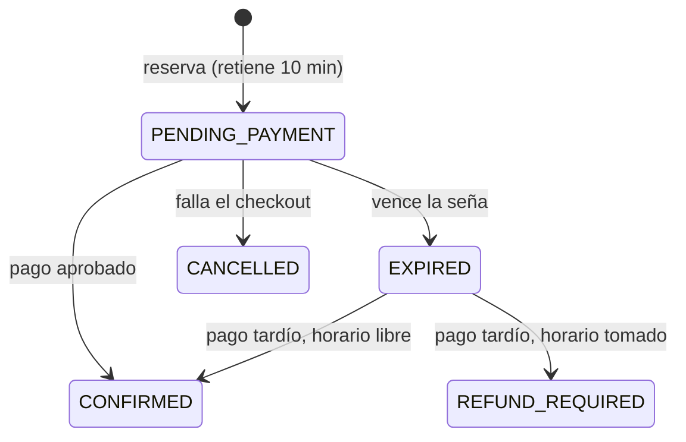

# TurnoYa

Reserva de turnos **con seña obligatoria vía Mercado Pago** para peluquerías, consultorios y centros de estética.

**El problema:** el cliente reserva, no va y el negocio pierde ese horario. **La solución:** el turno solo se
confirma cuando el cliente paga una seña. Mientras paga, el horario queda retenido 10 minutos; si no paga, se libera solo.

> Etapa 2 de 4: núcleo de reservas y pagos + eventos en Kafka. Próximas: asistente de WhatsApp con IA y planes pagos.

## Decisiones técnicas destacadas

| Problema | Solución | Dónde |
|---|---|---|
| Dos clientes reservan el mismo horario al mismo tiempo | Lock pesimista (`SELECT ... FOR UPDATE`) sobre el negocio + chequeo de solapamiento en la misma transacción. Test con 10 hilos simultáneos: gana exactamente uno. | `BookingService`, `BookingConcurrencyIT` |
| Llamar a Mercado Pago con el lock tomado frena todas las reservas del negocio | La reserva se hace en dos pasos: transacción corta para retener el horario y, afuera, la creación del checkout. Si Mercado Pago falla, el horario se libera. | `BookingService#reserve` |
| Mercado Pago reintenta los webhooks | Idempotencia con la tabla `processed_webhook` (unique constraint) en la misma transacción que la confirmación | `PaymentNotificationService` |
| Webhooks falsificados | Verificación HMAC-SHA256 del header `x-signature` con comparación en tiempo constante. No se confía en el body: se consulta el pago a la API. | `MercadoPagoSignatureVerifier` |
| El cliente paga después de que venció la seña | Si el horario sigue libre se confirma igual; si otro lo tomó, la reserva pasa a `REFUND_REQUIRED` | `BookingService#applyApprovedPayment` |
| El job de vencimiento y el webhook modifican la misma reserva | `@Version` (lock optimista): gana el pago | `HoldExpirationJob` |
| Publicar eventos sin perderlos ni inventarlos | Transactional outbox: el evento se guarda en la misma transacción y un relay lo publica en Kafka (topic por agregado, key = id de la reserva para conservar el orden, header `eventId` para deduplicar) | `outbox/` |
| Testear lógica que depende del tiempo | `Clock` inyectable: los tests "adelantan el reloj" | `MutableClock` |

## Ciclo de vida de una reserva



## Stack

Java 21 · Spring Boot 4 · Spring Data JPA / Hibernate · PostgreSQL · Flyway · Mercado Pago (Checkout Pro + webhooks) ·
Kafka · JUnit 5 · MockMvc · Docker · GitHub Actions · OpenAPI/Swagger

## Correr el proyecto

Sin instalar nada (H2 en memoria y pagos simulados):

```bash
mvn spring-boot:run
```

- **App web:** http://localhost:8080 — reservar turno (cliente) y agenda del día (negocio)
- **Swagger:** http://localhost:8080/swagger-ui/index.html
- Se carga un negocio de ejemplo ("Barbería Don Pepe"); `GET /api/businesses` devuelve sus IDs.

El frontend es HTML + JavaScript sin frameworks, servido por el mismo Spring Boot (`src/main/resources/static`):
un solo deploy, sin CORS ni build de Node. Los datos del usuario se insertan con `textContent`, nunca como HTML.

Con PostgreSQL y Kafka (los eventos van al topic `turnoya.booking`):

```bash
docker compose up --build
```

Sin el perfil `kafka`, los eventos del outbox se escriben en el log.

Con Mercado Pago real (credenciales de prueba):

```bash
MP_ACCESS_TOKEN=TEST-... MP_WEBHOOK_SECRET=... PUBLIC_BASE_URL=https://tu-url-publica mvn spring-boot:run -Dspring-boot.run.profiles=mercadopago
```

## Probar el flujo

```bash
# 1. Horarios libres
curl "localhost:8080/api/businesses/{businessId}/availability?serviceId={serviceId}&date=2026-10-08"

# 2. Reservar (devuelve checkoutUrl y la seña a pagar)
curl -X POST localhost:8080/api/businesses/{businessId}/bookings -H "Content-Type: application/json" \
  -d '{"serviceId":"{serviceId}","customerName":"Ana","customerPhone":"3518000001","startAt":"2026-10-08T13:00:00Z"}'

# 3. Simular el pago (solo en desarrollo)
curl -X POST localhost:8080/dev/payments/{bookingId}/approve

# 4. Ver la reserva confirmada
curl localhost:8080/api/bookings/{bookingId}
```

## Tests

```bash
mvn verify   # 15 unitarios (surefire) + 11 de integración (failsafe), Kafka embebido sin Docker
```

## Roadmap

- [x] **MVP:** agenda, reservas con seña (pago simulado), vencimiento de señas, webhooks idempotentes, outbox
- [ ] **En pausa:** Mercado Pago real (la integración ya está escrita, se activa con el perfil `mercadopago`)
- [x] **Relay del outbox a Kafka** (perfil `kafka`)
- [ ] **En pausa:** asistente de WhatsApp con la API de Claude
- [ ] **Después:** multi-tenant con API keys, panel del negocio, planes pagos, deploy
